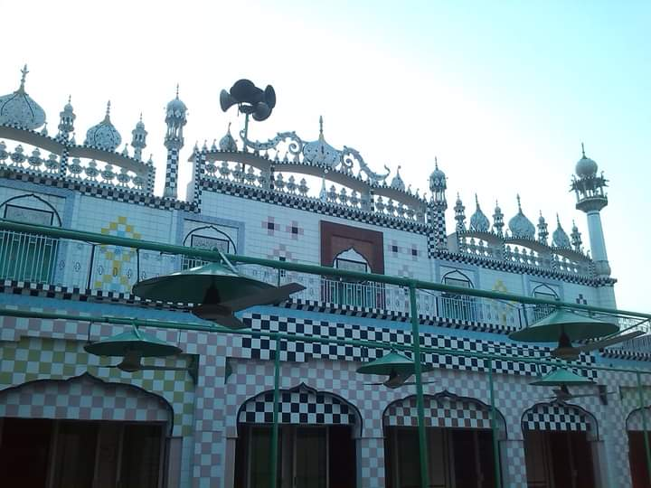

# Bhagwal – A Village and Union Council Of Kharian Tehsil, Gujrat District, Punjab, Pakistan 🇵🇰

This repository is dedicated to the documentation, digital archiving, and awareness of **Bhagwal** (not *Bhugwal*), a village located in **Tehsil Kharian, District Gujrat, Punjab, Pakistan**.

---

## 📍 Location

- **District**: Gujrat  
- **Tehsil**: Kharian  
- **Province**: Punjab  
- **Country**: Pakistan  
- **Coordinates**: `32.8239° N, 73.9549° E`

You can view Bhagwal on:  
- [🌍 OpenStreetMap](https://www.openstreetmap.org/search?query=Bhagwal%20Gujrat#map=16/32.8239/73.9549)  
- [🗺️ Google Maps](https://maps.google.com/?q=Bhagwal,+Gujrat,+Punjab,+Pakistan)  
- [📘 Wikipedia](https://en.wikipedia.org/wiki/Bhagwal,_Gujrat)

---

## ✅ Correct Spelling

Please note:  
- ✅ **Correct**: Bhagwal  
- ❌ **Incorrect**: Bhugwal (previously used on some outdated map services)  

The name has been corrected in [OpenStreetMap](https://www.openstreetmap.org/) and efforts are ongoing to update third-party services.

---

## 🕌 Notable Landmarks

- **Madni Masjid**
- **Jamia Masjid Gulzare Madina**
- **Jamia Masid Hazrat Bilal**
- **Masjid Abbas**
- **Makki Masjid** 
- **Masjid Nimra**  
- **Janaza Gah**  
- **Govt. High School (Boys & Girls)**  
  - Main Street 01–04  
  - محلہ دکھن Southern Street  
  - Narrow Street  
  - یونین کونسل والی گلی

---

## 🖼 Media Gallery

- ## 📸 Photos from Bhagwal Village

### 🏫 Government High School Bhagwal

### 🕌 Jamia Masjid Gulzar-e-Madina

### 🚏 Bhagwal Sign Board

### 🌾 Chappar Bhagwal Area

More visual content is welcome — feel free to contribute.

---

## 🛠 Community Contribution

If you would like to:  
- Share historical facts, media, or maps about Bhagwal  
- Report incorrect information on mapping services  
- Help improve the digital presence of the village  

You can:  
- Fork this repository and make a Pull Request  
- Open an Issue with your suggestions  
- Contact the maintainers  

---

## 🤝 Acknowledgements

- **OpenStreetMap contributors**  
- **Wikipedia contributors**  
- All individuals working to document local geography and preserve cultural identity online.

---

> “village like Bhagwal, Kharian Tehsil Gujrat District hold big histories. Let’s make sure they are remembered and recognized — correctly.”  
